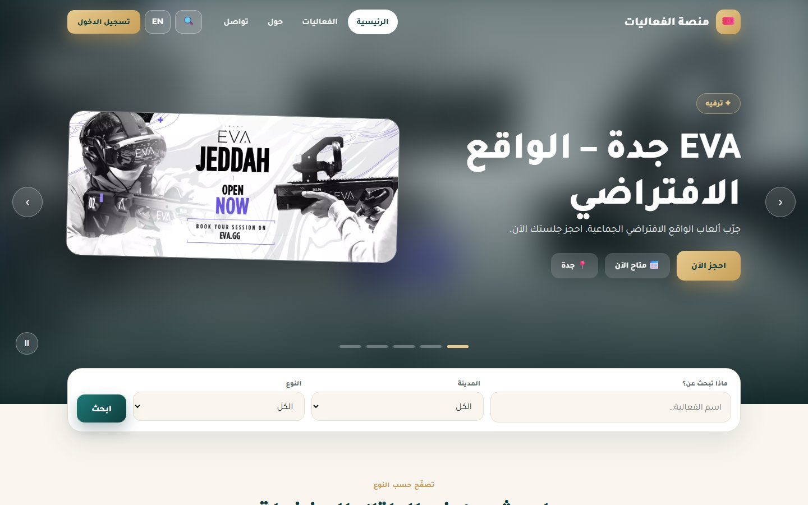
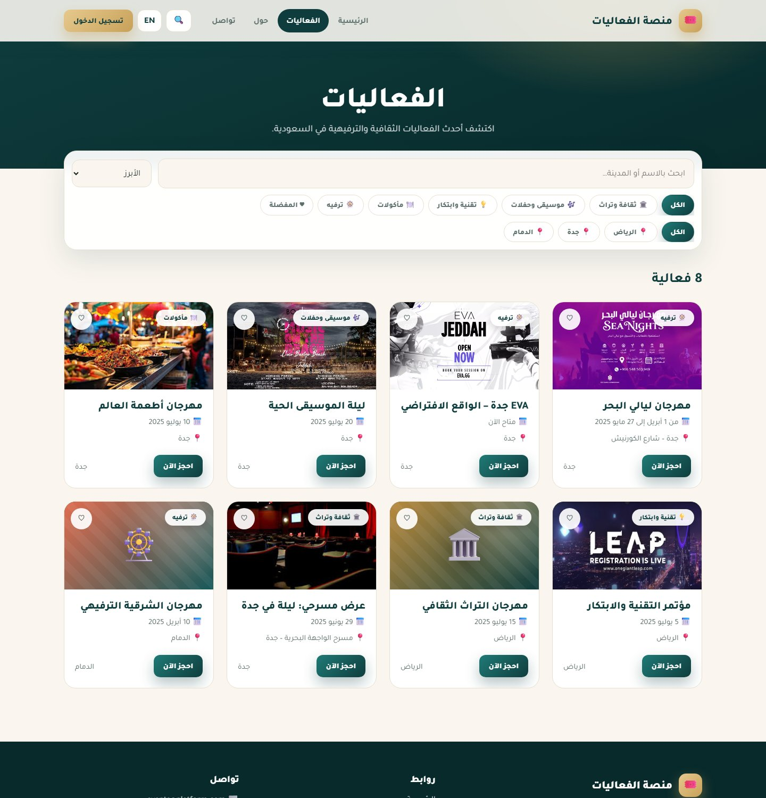
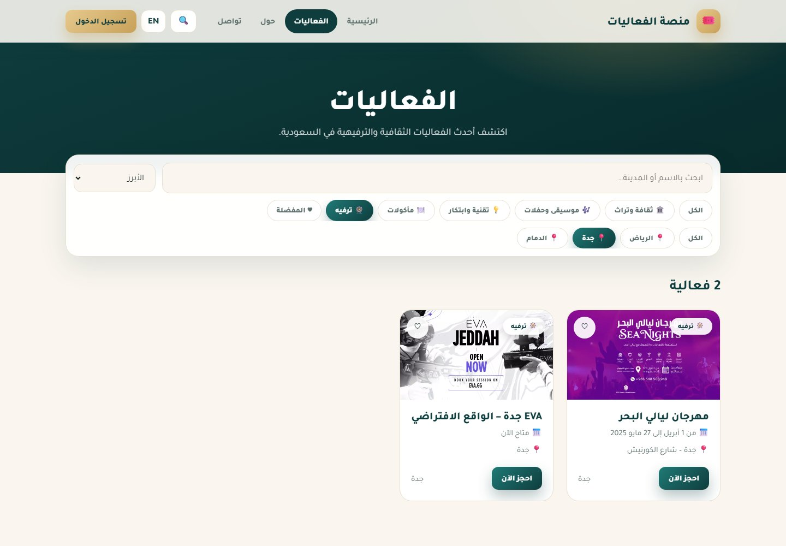
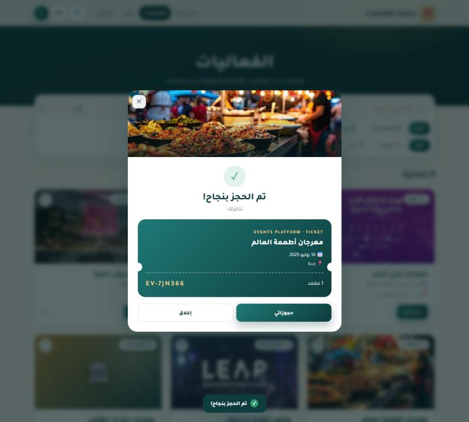
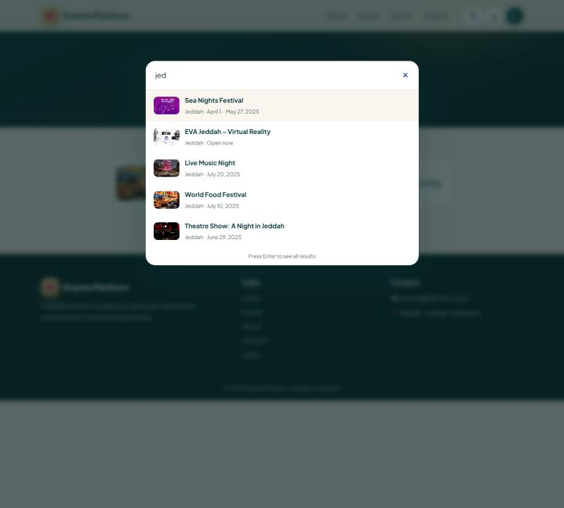
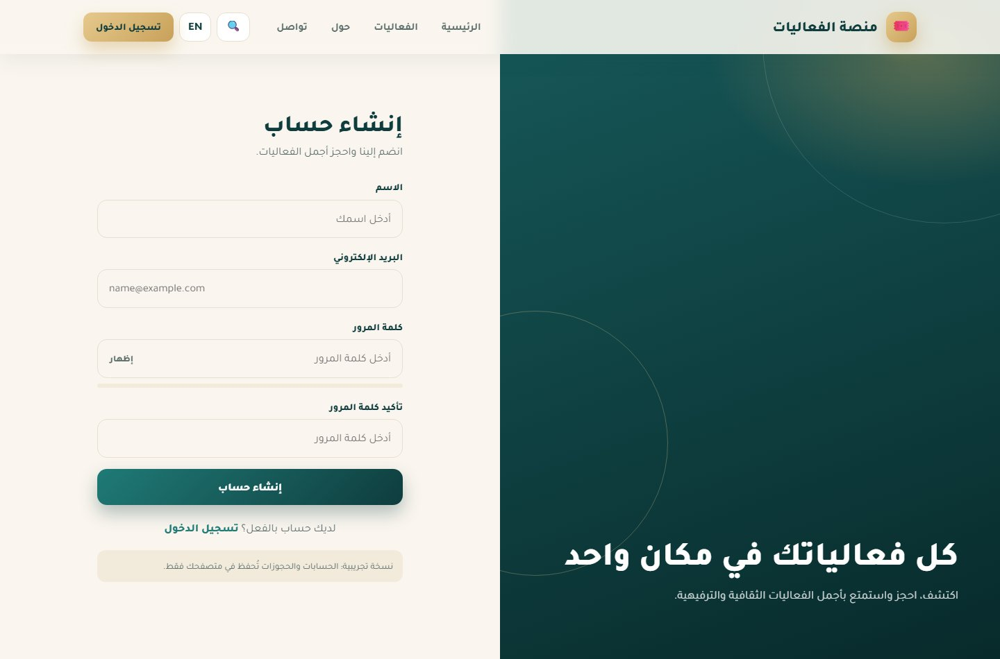
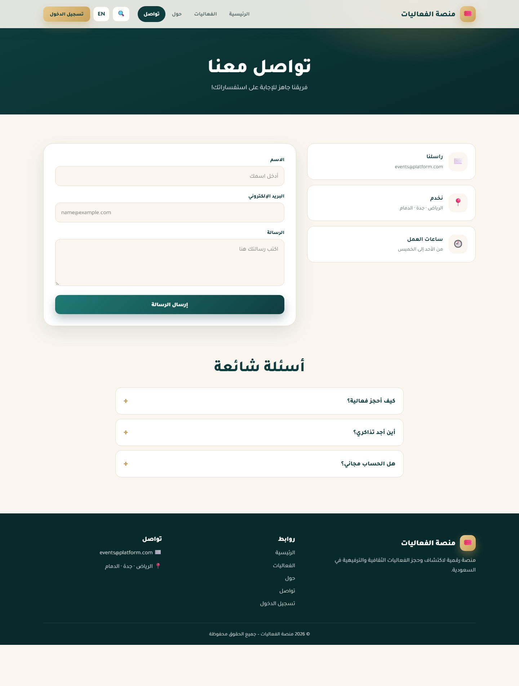
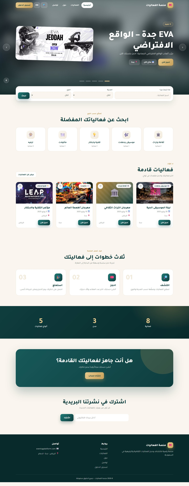
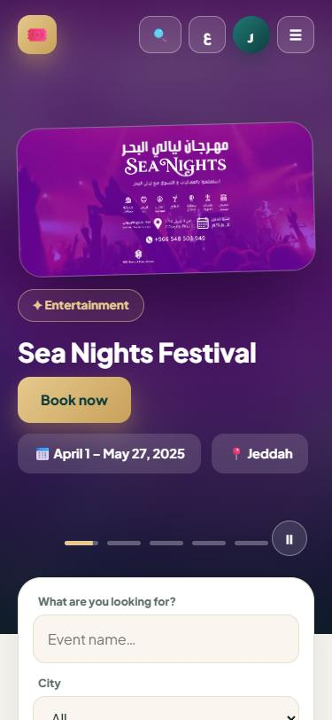
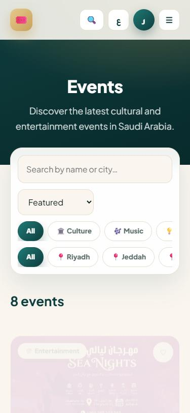

<div align="center">

# 🎟️ منصة الفعاليات · Events Platform

**Discover and book the best cultural and entertainment events in Saudi Arabia.**
A bilingual (Arabic / English) events website with a cinematic slider, live search, favourites, accounts and ticket booking.

[**▶ Live demo**](https://ritalalghates.github.io/Events-website/) · No build step · HTML · CSS · JavaScript




</div>

## ✨ Features

- **Bilingual with real RTL / LTR** – switch between Arabic and English from the header; direction, typography and all content follow
- **Cinematic hero slider** – blurred poster backdrop, poster card, auto-play with animated progress dots, arrows, swipe, keyboard, pause and hover-pause
- **Quick search** by name, city and category, plus a **global search overlay** (press `/`) with live results and keyboard navigation
- **Events catalogue** – filter by category and city, search, sort, and keep **favourites** (♥)
- **Booking flow** – choose the number of seats, confirm and receive a ticket with a booking code
- **Accounts** – sign up and log in (inline validation, password strength meter, show / hide password)
- **My bookings** – view and cancel your tickets
- **Contact form** with validation and an FAQ accordion
- **Polished UI** – deep teal, sand and gold design system, animated counters, scroll-reveal, scroll progress bar, toasts, back-to-top
- **Responsive and accessible** – mobile menu, semantic landmarks, ARIA labels, `Esc` closes dialogs, reduced-motion support

## 🖼️ Screens

<table>
  <tr>
    <td width="50%"><b>Events with filters</b><br></td>
    <td width="50%"><b>Category + city filter</b><br></td>
  </tr>
  <tr>
    <td><b>Booking confirmation ticket</b><br></td>
    <td><b>Global search</b> (English)<br></td>
  </tr>
  <tr>
    <td><b>Sign up</b><br></td>
    <td><b>Contact</b><br></td>
  </tr>
</table>

### Full home page

<p align="center"></p>

### 📱 On mobile (English)

<p align="center">
  
  
</p>

## 🚀 Run it

No installation needed. Open `index.html` in a browser, or serve the folder:

```bash
python -m http.server 8000     # then open http://localhost:8000
```

## 🗂️ Project structure

```text
index.html      Home: hero slider, quick search, categories, upcoming events, how it works, stats
events.html     Catalogue with filters, search, sort and favourites
about.html      About, vision, mission and values
contact.html    Contact form and FAQ
login.html      Log in
signup.html     Sign up
bookings.html   My bookings
styles.css      Design system (RTL / LTR aware)
assets/data.js  Events data and Arabic / English translations
assets/app.js   i18n, layout, slider, search, favourites, auth, bookings
images/         Event posters
docs/           README screenshots
```

### Adding or editing events

Events and translations live in [`assets/data.js`](assets/data.js):

```js
{
  id: "tech", cat: "tech", city: "riyadh", ts: 20250705, img: "images/leap.png",
  title: { ar: "مؤتمر التقنية والابتكار", en: "Technology and Innovation Conference" },
  desc:  { ar: "…", en: "…" },
  date:  { ar: "5 يوليو 2025", en: "July 5, 2025" },
  place: { ar: "الرياض", en: "Riyadh" },
}
```

Events without an `img` get a generated poster (`art: { icon, c1, c2 }`).

## ℹ️ Notes

- This is a **front-end demo**: there is no server. Accounts (salted SHA-256 hashes), bookings, favourites and messages
  are stored in your own browser's `localStorage` and never leave your device. Do not reuse a real password.
- The contact form and newsletter are demos and do not send e-mail.
- Event posters are used for demonstration purposes.
